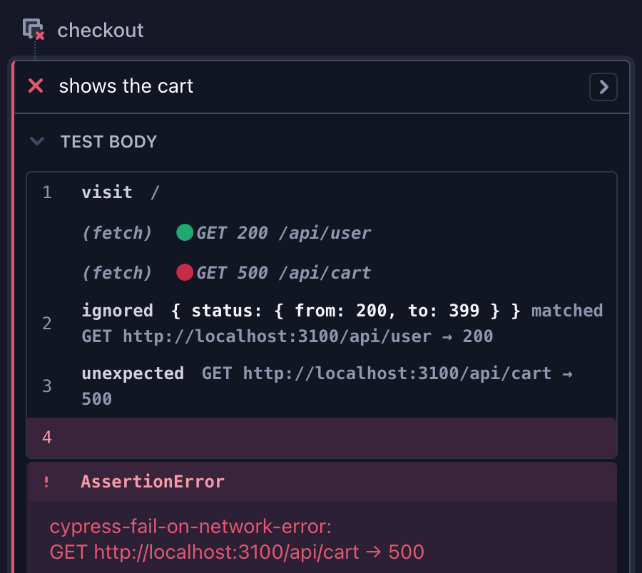

# cypress-fail-on-network-error

[](https://www.npmjs.com/package/cypress-fail-on-network-error)
[](https://github.com/nils-hoyer/cypress-fail-on-network-error/actions/workflows/ci.yml)
[](https://github.com/sponsors/nils-hoyer)

Fail Cypress tests when the application under test makes a network request you did not expect, such as an API call that returns a `500`.

To fail tests on `console.error()` calls, see [cypress-fail-on-console-error](https://www.npmjs.com/package/cypress-fail-on-console-error).

## Installation

```sh
npm install cypress-fail-on-network-error --save-dev
```

## Usage

Call `failOnNetworkError()` in your support file, `cypress/support/e2e.ts`:

```ts
import failOnNetworkError from 'cypress-fail-on-network-error';

failOnNetworkError({
    // fail on error responses
    ignoreRequests: [{ status: { from: 200, to: 399 } }],
});
```

A request that no entry in `ignoreRequests` matches fails the test and is logged to the command log:


## Config (optional)

| Option           | Default | Description |
| ---------------- | ------- | ----------- |
| `ignoreRequests` | `[]`    | Requests that don't fail a test, as `string` (shorthand for `{ url }`), `{ url, method, status, predicate }`, or a function (shorthand for `{ predicate }`). A request that matches any entry is excluded. `requests`, its old name, still works. |
| `debug` | `false` | Also logs each request that `ignoreRequests` ignores, with the entry that matched it. See [Debugging](#debugging). |

```ts
import failOnNetworkError, { Config } from 'cypress-fail-on-network-error';

const config: Config = {
    ignoreRequests: [
        { status: { from: 200, to: 399 } },
        'analytics', // any request whose URL contains "analytics"
        { url: /\/api\/feature-flags/, method: 'GET', status: 404 },
        { method: 'POST', status: 409 }, // a 409 from any POST request
        { method: ['HEAD', 'OPTIONS'] }, // any HEAD or OPTIONS request
        ({ url, status }) => status === 404 && url.endsWith('.map'),
    ],
};

failOnNetworkError(config);
```

### How requests are matched

- Every field an entry sets must match. A field it leaves out matches any value.
- `url` is a `string` or `RegExp` that matches anywhere in the full URL. Strings are converted with `new RegExp(string)`, so [escape special characters](https://javascript.info/regexp-escaping).
- `method` is any HTTP method, such as `GET`, `HEAD` or `OPTIONS`, in any case, or a list of methods, which matches any of them.
- `status` is a number, or a range `{ from, to }` that includes both ends.
- `predicate` is a function that gets the request's `method`, `url`, `requestHeaders`, and `status` and `responseHeaders` or `error`, and excludes it when it returns `true`. Header names are lower case, for example `({ responseHeaders }) => responseHeaders?.['x-expected-error'] === 'true'`. Request and response bodies are not available. It is called only when the other fields of its entry match. An error it throws fails the test.
- A request that fails without a response, for example when the connection is refused, has no status. Only entries without `status` match it.

## Change the config in a test

To change the ignored requests in a test, and to wait for pending requests, register the commands in your support file:

```ts
import failOnNetworkError, {
    addIgnoredRequestsCommands,
} from 'cypress-fail-on-network-error';

const failOnNetwork = failOnNetworkError(config);
addIgnoredRequestsCommands(failOnNetwork);
```

Then use them in a test. Changes last until the end of the test.

```ts
it('should tolerate an unavailable recommendations service', () => {
    cy.addIgnoredRequests([{ url: /\/api\/recommendations/, status: 503 }]);
    cy.visit('/');
});
```

| Command                                    | Description |
| ------------------------------------------ | ----------- |
| `cy.getIgnoredRequests()`                  | Yields `ignoreRequests`. |
| `cy.setIgnoredRequests(['foo', { url: /bar/ }])`    | Replaces `ignoreRequests`. |
| `cy.addIgnoredRequests([{ status: 404 }])` | Adds to `ignoreRequests`. |
| `cy.deleteIgnoredRequests(['foo'])`        | Removes equal entries from `ignoreRequests`, in any form: `'foo'` removes `{ url: 'foo' }`, and a predicate only the same function. |
| `cy.waitForRequests(timeout)`              | Waits for pending requests, see [below](#wait-for-pending-requests). |

To change other options, use `getConfig()` and `setConfig()`, which `failOnNetworkError()` returns. `setConfig()` accepts every form of entry:

```ts
const { getConfig, setConfig } = failOnNetwork;

Cypress.Commands.add('setDebug', (debug) => setConfig({ ...getConfig(), debug }));
```

## Wait for pending requests

A response that arrives after the test's last command is not checked. To check slow requests too, end the test with `cy.waitForRequests()`, which `addIgnoredRequestsCommands()` registers:

```ts
it('should check every request the page makes', () => {
    cy.visit('/');
    cy.waitForRequests();
});
```

`cy.waitForRequests(timeout = 10000)` waits until every request of the current test has a response or has failed. It checks every 500 ms, starting 500 ms after the command runs, so it also sees requests the page has just made. When the timeout passes first, the test continues without an error.

## Debugging

Click an `unexpected` entry in the command log to print the request, its status or error, and the `ignoreRequests` entries it was matched against to the browser console.

Set `debug: true` to also log each ignored request, with the entry that matched it:

```ts
failOnNetworkError({
    ignoreRequests: [{ status: { from: 200, to: 399 } }],
    debug: true,
});
```



## Contributing

1. Open an issue that describes the problem and the expected behavior.
2. Install dependencies with `npm ci`. The integration tests run Cypress in Chrome, which must be installed. `BROWSER=firefox` runs them in Firefox. CI runs Chrome and Firefox.
3. Make your change in `src/index.ts` and run `npm run build`. The tests run against `dist/`, which is not committed.
4. Run `npm run verify` (build, type check, format check, unit and integration tests). It must pass.
5. Open a PR with the implementation and tests. Don't change the version in `package.json`: the maintainer releases from GitHub Actions, which increases the version.
