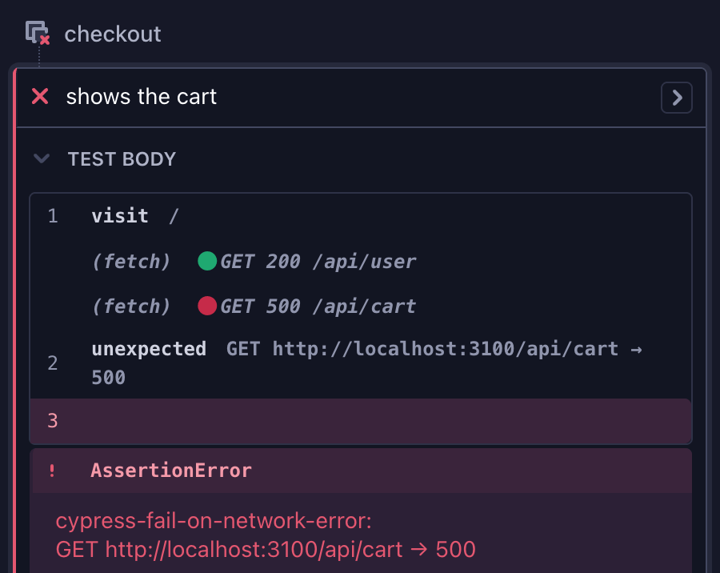

# cypress-fail-on-network-error

[](https://www.npmjs.com/package/cypress-fail-on-network-error)
[](https://github.com/nils-hoyer/cypress-fail-on-network-error/actions/workflows/ci.yml)
[](https://github.com/sponsors/nils-hoyer)

Fail Cypress tests when the application under test makes a network request you did not expect, such as an API call that returns a `500`.

To fail tests on `console.error()` calls, see [cypress-fail-on-console-error](https://www.npmjs.com/package/cypress-fail-on-console-error).

## Installation

```sh
npm install cypress-fail-on-network-error --save-dev
```

## Usage

Call `failOnNetworkError()` in your support file, `cypress/support/e2e.js` or `cypress/support/e2e.ts`:

```js
import failOnNetworkError from 'cypress-fail-on-network-error';

failOnNetworkError({
    // don't fail on successful responses
    ignoreRequests: [{ status: { from: 200, to: 399 } }],
});
```

Every XHR and `fetch` request is checked, whatever its status, so without the entry above a `200` fails the test too. Page loads from `cy.visit()` and scripts, stylesheets and images are not checked. Neither are requests that the browser cancels, because the page aborted them (`AbortController`, `xhr.abort()`) or navigated away.

When a request gets a response, or fails without one, and no entry in `ignoreRequests` matches it, the test fails with an error that starts with `cypress-fail-on-network-error:` and lists the requests of the current test:



## Config (optional)

| Option           | Default | Description |
| ---------------- | ------- | ----------- |
| `ignoreRequests` | `[]`    | Requests that don't fail a test, as `string` (shorthand for `{ url }`) or `{ url, method, status }`. A request that matches any entry is excluded. `requests`, its old name, still works. |

```ts
import failOnNetworkError, { Config } from 'cypress-fail-on-network-error';

const config: Config = {
    ignoreRequests: [
        { status: { from: 200, to: 399 } },
        'analytics', // any request whose URL contains "analytics"
        { url: /\/api\/feature-flags/, method: 'GET', status: 404 },
        { method: 'POST', status: 409 }, // a 409 from any POST request
        { method: ['HEAD', 'OPTIONS'] }, // any HEAD or OPTIONS request
    ],
};

failOnNetworkError(config);
```

### How requests are matched

- Every field an entry sets must match. A field it leaves out matches any value.
- `url` is a `string` or `RegExp` that matches anywhere in the full URL. Strings are converted with `new RegExp(string)`, so [escape special characters](https://javascript.info/regexp-escaping).
- `method` is any HTTP method, such as `GET`, `HEAD` or `OPTIONS`, in any case, or a list of methods, which matches any of them.
- `status` is a number, or a range `{ from, to }` that includes both ends.
- A request that fails without a response, for example when the connection is refused, has no status. Only entries without `status` match it.

## Change the config in a test

`failOnNetworkError()` returns `getConfig()` and `setConfig()`. Wrap them in a command in your support file:

```ts
const { getConfig, setConfig } = failOnNetworkError(config);

Cypress.Commands.add('setIgnoredRequests', (ignoreRequests) =>
    setConfig({ ...getConfig(), ignoreRequests })
);
```

Then use it in a test. Changes last until the end of the test. The command replaces `ignoreRequests`, so include the entries you still need:

```ts
it('should tolerate an unavailable recommendations service', () => {
    cy.setIgnoredRequests([
        { status: { from: 200, to: 399 } },
        { url: /\/api\/recommendations/, status: 503 },
    ]);
    cy.visit('/');
});
```

`getConfig()` returns each entry normalized: a string becomes `{ url }`, a number in `status` becomes `{ from, to }`, and `method` is upper case. Change the config through `setConfig()`, which accepts every form, rather than by changing what `getConfig()` returns.

For TypeScript, see the command declarations in this repository's [support file](https://github.com/nils-hoyer/cypress-fail-on-network-error/blob/main/cypress/support/e2e.ts).

## Wait for pending requests

A response that arrives after the test's last command is not checked. To check slow requests too, wrap `waitForRequests()` in a command. Take it from the same `failOnNetworkError()` call as `getConfig()` and `setConfig()`, because each call registers its own listeners.

```ts
const { getConfig, setConfig, waitForRequests } = failOnNetworkError(config);

Cypress.Commands.add('waitForRequests', (timeout) => waitForRequests(timeout));
```

```ts
it('should check every request the page makes', () => {
    cy.visit('/');
    cy.waitForRequests();
});
```

`waitForRequests(timeout = 10000)` waits until every request of the current test has a response or has failed. It checks every 500 ms, starting 500 ms after the command runs, so it also sees requests the page has just made. When the timeout passes first, the test continues without an error.

It does not wait for requests that were pending when the page unloaded, such as after `cy.visit()` to another page; a response that still arrives is checked. Electron and Firefox report nothing for a request that the page aborts, so `waitForRequests` waits for it until the timeout.

## Contributing

1. Open an issue that describes the problem and the expected behavior.
2. Install dependencies with `npm ci`. The integration tests run Cypress in Chrome, which must be installed. `BROWSER=firefox` runs them in Firefox. CI runs Chrome and Firefox.
3. Make your change in `src/index.ts` and run `npm run build`. The tests run against `dist/`, which is not committed.
4. Run `npm run verify` (build, type check, format check, unit and integration tests). It must pass.
5. Open a PR with the implementation and tests. Don't change the version in `package.json`: the maintainer releases from GitHub Actions, which increases the version.
